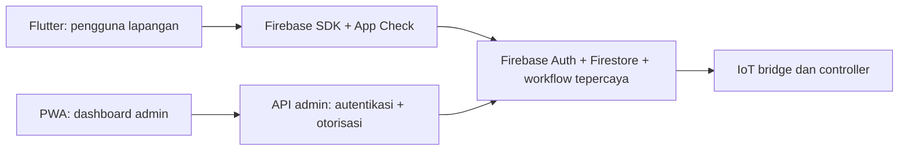

# Lingkup produk SUBAKO: aplikasi pengguna dan dashboard admin

Klarifikasi pemilik, 6 November 2026: **Flutter apps untuk sisi user; PWA untuk sisi admin dashboard.** Pembagian ini menjadi acuan pengembangan berikutnya. Dua repository menghasilkan dua client dalam satu sistem SUBAKO.

| Client | Pengguna utama | Lingkup |
|---|---|---|
| [Flutter Android](https://github.com/bligede/subako-flutter-apps) | Petani, operator, Pekaseh | Beranda Subak, pemantauan air, jadwal/aturan, alert, Buku Catatan Air, laporan site dan asisten AI |
| [Web-PWA admin](https://github.com/bligede/subako-web-apps-by-mikiko) | Admin Mikiko/platform dan pengelola berizin | Dashboard pengawasan, administrasi akun/membership/site/perangkat, audit, konfigurasi dan laporan administrasi lintas site sesuai izin |

Matriks ini menentukan tempat fitur dikembangkan; bukan perubahan otomatis pada role, membership atau permission yang sudah tersimpan. Admin tetap dapat meninjau pengalaman aplikasi pengguna dengan akses yang sah. Role operasional tetap dapat membaca dashboard PWA sesuai izin yang berlaku. Shortcut admin di demo Flutter dihilangkan agar layar login mewakili pengguna utama.

## Pengalaman pengguna Flutter

- Navigasi utama: **Beranda, Monitoring, Operasional, Catatan Air, Profil**.
- Demo menampilkan pilihan **Petani, Operator, Pekaseh**.
- Petani membaca informasi yang diizinkan; operator menangani operasional sesuai permission; keputusan alokasi air tetap mengikuti kewenangan Pekaseh/Paruman.
- Profil menampilkan identitas dan lokasi Subak; UID, kode permission, ID project dan nama model AI tidak ditempatkan pada alur profil pengguna.
- Administrasi akun, pengaturan hak akses dan provisioning perangkat dikembangkan pada PWA admin.

Pembagian layar tidak menggantikan otorisasi server. Akses tetap diperiksa berdasarkan akun aktif, membership aktif, site dan permission. Tidak ada hak admin yang diperoleh dari pilihan role atau nama aplikasi.

## Status integrasi saat ini

| Area | Flutter | PWA admin |
|---|---|---|
| Backend yang sudah diimplementasikan | Firebase Auth/Firestore development | FastAPI + PostgreSQL; SQLite untuk lokal |
| Sesi | Firebase Auth | Cookie HttpOnly, CSRF dan sesi API |
| Data demo | Simulator lokal / fixture Firestore SIMULATION | Simulator dan database PWA SIMULATION |
| Identitas/data bersama antar-client | Belum dihubungkan | Belum dihubungkan |

Project `subako-dev-mikiko` yang dibuat pada iterasi Flutter bukan bukti bahwa PWA telah beralih ke Firebase. Kredensial PWA dan Firebase terpisah. Data atau akun di salah satu client belum otomatis terlihat di client lain. PostgreSQL, model sesi dan data PWA yang ada dipertahankan sampai adapter/migrasi diuji.

## Target integrasi

Firebase menjadi sumber kanonik untuk identitas dan data operasional bersama sesuai fondasi v0.2. PWA admin perlu adapter backend untuk membaca dan mengelola sumber yang sama; jangan menjalankan dua sumber authoritative dengan dual-write tanpa proses rekonsiliasi.

Diagram adalah target integrasi. Adapter API admin ke Firebase dan koneksi hardware belum diimplementasikan. Perintah fisik tetap ditolak pada development saat ini.

Urutan pekerjaan integrasi:

1. Petakan UID, site/device ID, membership, permission, satuan dan timestamp PWA ke kontrak v0.2; tentukan cutover dan rollback sebelum pemindahan data.
2. Hubungkan identitas PWA dengan Firebase melalui pertukaran sesi yang diverifikasi server. Pertahankan cookie HttpOnly dan proteksi CSRF untuk browser; jangan memakai Firebase ID token sebagai password sesi PWA lama.
3. Tambahkan adapter API admin ke data kanonik dengan pemeriksaan permission/site eksplisit. Admin SDK hanya berada pada server, tidak di browser. Daftarkan konfigurasi Firebase Web/App Check tersendiri bila dibutuhkan; konfigurasi Android bukan konfigurasi PWA.
4. Implementasikan administrasi akun/membership/perangkat secara bertahap beserta audit. Layar daftar pengguna yang sudah ada belum merupakan CRUD akun lengkap.
5. Uji lintas client: perubahan admin terbaca di Flutter, pencabutan akses berlaku di kedua client, isolasi site, idempotensi workflow dan kondisi offline. Baru sesudah itu nyatakan integrasi selesai.

Release Flutter 0.2.2 hanya menyesuaikan lingkup, presentasi dan dokumentasi client pengguna. Ia tidak menjalankan migrasi backend PWA, menyamakan password, atau mengaktifkan command fisik. Generasi Gemini dari mesin kerja masih timeout sebagaimana laporan verifikasi 0.2.1.
